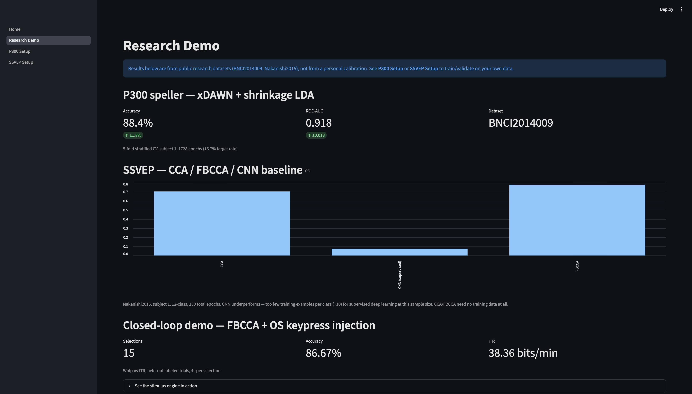
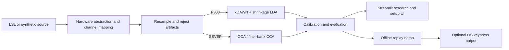

# Dual-Paradigm BCI Speller — P300 + SSVEP

A research-data BCI speller that compares P300 and SSVEP decoding, provides a Streamlit calibration workflow, and keeps replayed keyboard output distinct from a true live-headset closed loop.

## Results

Reported by the repository's benchmark suite; these numbers were not rerun during this review.

| Paradigm / test | Result |
|---|---|
| P300, BNCI2014009 subject 1, 5-fold CV | 88.4% ± 1.8% accuracy; 0.783 balanced accuracy; 0.918 ± 0.013 ROC-AUC |
| SSVEP FBCCA, Nakanishi2015 subject 1, 12 classes | 77.8% zero-shot accuracy; standard CCA reports 70.4% |
| Paced replay to online decoder and OS keypress | 86.67% accuracy and 38.36 bits/min over 15 selections; uses prerecorded epochs, not a live EEG loop |
| Mock calibration synchronization | 119 epochs; marker counts matched the flash schedule |



## Architecture



## Quickstart and verification

The Streamlit app reached startup in the prepared Python environment. No physical headset was connected; treat this as an app-startup check, not hardware validation.

```bash
python3.11 -m venv .venv
source .venv/bin/activate
pip install -r requirements.txt
streamlit run app/Home.py
```

On macOS, the project documents a separate `liblsl` install and `PYLSL_LIB` setting for real LSL devices. The synthetic stream is the no-hardware path.

## Limitations

- All benchmark data are public research data; there is no validated live-headset closed loop.
- SSVEP supervised CNN remains near chance at the tested calibration budgets; use the documented FBCCA result instead.
- Personal calibration and warm-start behavior need independent evaluation with actual users and hardware.
- Predictive text / OS keypress output is a demo feature, not evidence of usable assistive performance.

## Next steps

1. Add a reproducible clean-install test and a no-hardware demo check.
2. Validate timing, artifacts, and decoding on a supported physical headset.
3. Measure end-to-end decision latency and user-level spelling rate.
4. Add safety controls, explicit consent, and a non-keypress output mode.
